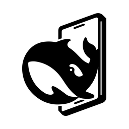
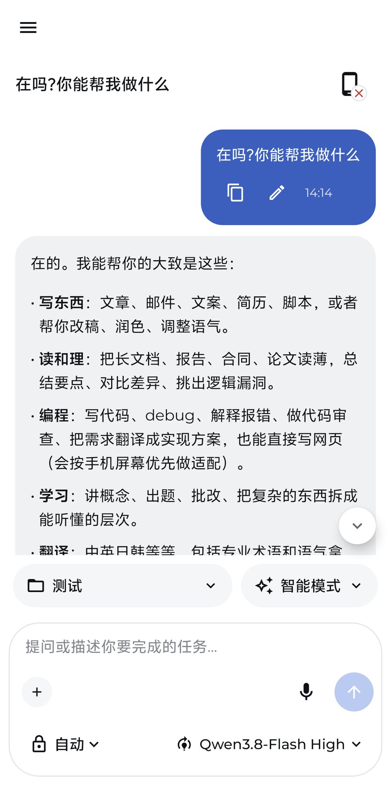
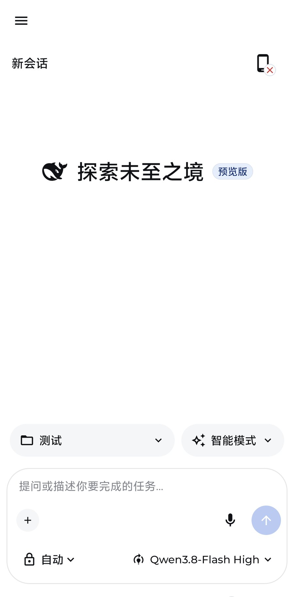
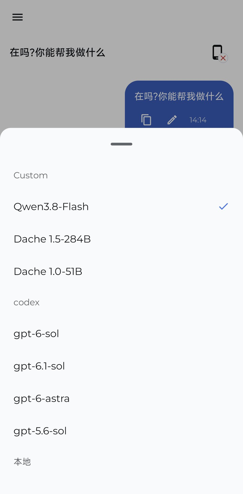
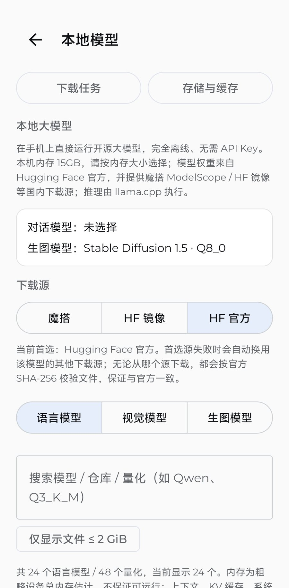
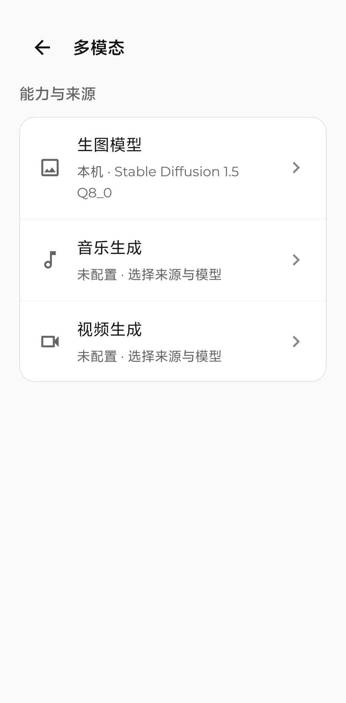
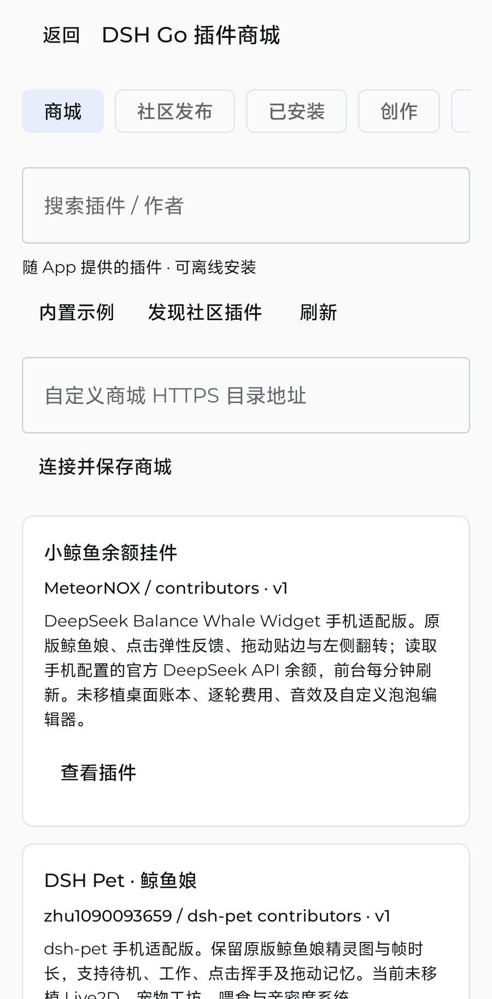
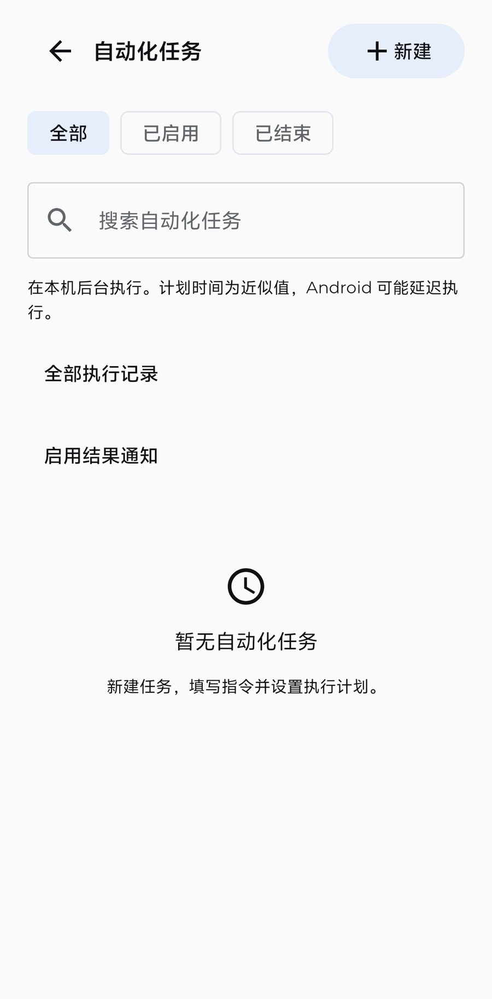
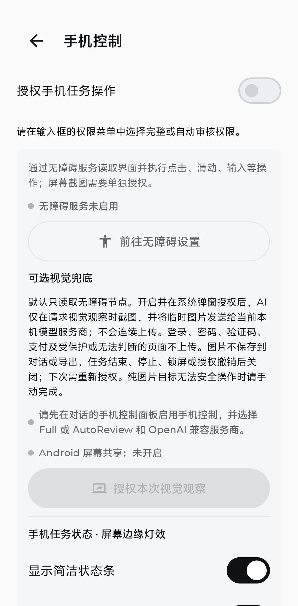

<p align="center"></p>

# DSHarness Go

**DSHarness Go 是 DeepSeek Harness 的移动端生态项目** —— 为 DeepSeek Harness 提供原生 Android 客户端。

> Android 预览版已发布 · iOS 版本开发中（暂不提供下载）。

它让你在手机上连接电脑端 Harness 继续对话，也可以脱离电脑，直接使用自有 API 供应商、离线 GGUF 模型 /
本机生图独立运行；同时提供手机自动化、插件扩展，并且**不需要在 Android 上安装 Ubuntu/Linux 模拟器，也不需要 root**。

<p>
  <b>原生 Kotlin + Jetpack Compose</b> ·
  <b>Android 8.0+ · arm64-v8a</b> ·
  <b>预览版</b> ·
  <b>DeepSeek Harness 移动端生态</b>
</p>

> 本仓库提供 Android 源码、项目介绍、构建文档与正式 APK 下载。
> [下载 v1.0.12](https://github.com/mionio233-collab/dsharness-go/releases/tag/v1.0.12) · [浏览源码](./app/src/main) · [构建说明](./docs/BUILDING.md) · [AGPL-3.0](./LICENSE)

## 目录

- [项目介绍](#项目介绍)
- [两种使用方式](#两种使用方式)
- [功能](#功能)
- [截图](#截图)
- [快速开始](#快速开始)
- [手机自动化与隐私](#手机自动化与隐私)
- [常见问题](#常见问题)
- [关于 DeepSeek Harness 的权利声明](#关于-deepseek-harness-的权利声明)
- [下载与链接](#下载与链接)
- [许可](#许可)

## 项目介绍

DeepSeek Harness（DSH）把模型、工具、插件与工作区串成一套可编程的 AI Agent 工作环境。DSHarness Go
把这种能力延伸到手机端，解决两类需求：

1. **人不在电脑前，也想继续电脑上的会话**：通过局域网或同账号中继连接电脑端 DSH，手机端继续对话、
   查看任务进度，模型与项目上下文保持一致；
2. **没有电脑，或想完全在手机上运行**：直接接入自有 API 供应商，或下载离线 GGUF 模型、本机生图模型，
   在手机本地完成推理与生成。

DSHarness Go 是移动端生态客户端，**不是 DeepSeek 官方产品**；DeepSeek Harness 的权利归 DeepSeek 公司所有
（见下方权利声明）。

## 两种使用方式

```text
方式一：连接电脑端 Harness
┌──────────────┐   局域网扫码 / 同账号中继   ┌──────────────────┐
│ 电脑端 DSH   │ ─────────────────────────▶ │ DSHarness Go     │
│ 模型/工具/项目│ ◀───────────────────────── │ （Android 手机） │
└──────────────┘        会话与任务同步       └──────────────────┘

方式二：手机独立运行（本地 API 模式）
┌──────────────────┐    自有 API 供应商 / 离线 GGUF / 本机生图
│ DSHarness Go     │ ──────────────────────────────────────────▶ 手机本地或云端
│ （Android 手机） │     无需电脑、无需 Ubuntu 模拟器、无需 root
└──────────────────┘
```

| | 连接电脑端 Harness | 手机独立运行 |
| --- | --- | --- |
| 需要电脑 | 需要（局域网或同账号中继） | 不需要 |
| 模型来源 | 电脑端配置的模型 | 手机端 API 供应商 / 离线 GGUF |
| 适合场景 | 继续桌面对话、使用电脑端工具与项目上下文 | 随身使用、离线使用、隐私敏感场景 |
| 网络 | 局域网或中继 | 可完全离线 |

## 功能

### 连接与同步

- 局域网扫码配对，或同账号中继连接，无需公网 IP；
- 断线重连、增量同步；打开会话优先使用本地缓存，超大会话不再一次性加载；
- 电脑端问答卡片（AskUserQuestion）可在手机端直接回答。

### 对话与模型

- 流式回复、工具调用、推理等级（低 / 中 / 高）与任务模式切换；
- 多供应商支持：DeepSeek、OpenAI、Anthropic 兼容接口，自定义 Base URL 与模型列表；
- 模型能力标记（上下文长度、视觉、推理），会话内快速切换。

### 本地模型与本机生图

- 内置 **llama.cpp** 端侧推理，可下载或导入 GGUF 模型，支持视觉模型与多模态输入；
- 内置 **stable-diffusion.cpp**，本机文生图无需云端；也支持 OpenAI Images 兼容接口；
- 本地模型管理：下载任务、存储占用、导入与删除。

### 手机自动化

- 基于 Android 无障碍服务的手机 Agent：观察界面、点击、输入、长按、拖动、坐标手势与截图；
- 支持后台自动化任务与执行计划（受 Android 调度限制，计划时间为近似值）；
- 可选的视觉兜底，需单独授权屏幕捕获，临时图片不会保存到对话或导出。

### 插件、工作区与文件

- DSH Go 插件商城：安装/启用/禁用插件，支持自定义 HTTPS 商城目录；
- 工作区管理与文件浏览/编辑；
- 手机端技能（SKILL.md）导入与使用。

## 截图

> 截图使用测试环境，界面可能随版本变化。

| 对话 | 新建会话 | 模型选择 |
| --- | --- | --- |
|  |  |  |

| 本地模型 | 多模态 · 本机生图 | 插件商城 |
| --- | --- | --- |
|  |  |  |

| 自动化任务 | 手机控制 |
| --- | --- |
|  |  |

## 快速开始

1. **安装 App（Android）**：从 [Releases](https://github.com/mionio233-collab/dsharness-go/releases) 下载签名 APK
   （arm64-v8a，Android 8.0+），允许「安装未知来源应用」后安装。iOS 版本开发中，暂不提供下载；
2. **选择使用方式**：
   - 远程连接：电脑端启用 DSH Go 互联插件，手机扫码或同账号配对；
   - 独立使用：设置 → 手机端 API 服务 配置供应商，或设置 → 本地模型 下载模型；
3. **开始使用**：新建会话即可聊天、调用工具、生图，或在会话中启用手机控制。

## 手机自动化与隐私

- 手机控制默认关闭，需要在会话中的「手机控制」面板显式启用，并授予无障碍服务；
- 默认只读取无障碍节点；视觉兜底需额外授权屏幕捕获，仅在请求视觉观察时临时截图；
- 登录、密码、验证码、支付及受保护页面不会上传；图片不保存到对话或导出，任务结束/撤销授权后关闭；
- 本机模型、本机生图与本地缓存都在设备上处理；账号与配对令牌保存在本机加密存储中。

## 常见问题

<details>
<summary>需要电脑才能用吗？</summary>

不需要。手机端可以独立使用自有 API 供应商，也可以下载本地 GGUF 模型离线推理；想继续电脑上的会话时再连接电脑端 Harness。
</details>

<details>
<summary>需要在 Android 上安装 Ubuntu / 模拟器吗？</summary>

不需要。DSHarness Go 是原生 Android 应用，直接调用系统能力，无需 Linux 模拟器、无需 root。
</details>

<details>
<summary>iOS 版本什么时候发布？</summary>

iOS 版本仍在开发中，暂不提供下载。发布后会在下载页和 GitHub Releases 公布。
</details>

<details>
<summary>为什么只提供 arm64-v8a？</summary>

端侧大模型与生图引擎依赖 arm64 原生库，当前仅打包 arm64-v8a；绝大多数近几年的 Android 手机都支持。
</details>

<details>
<summary>源码是否公开？</summary>

Android 源码已在本仓库公开，参阅 [app](./app)、[构建说明](./docs/BUILDING.md) 和 [LICENSE](./LICENSE)。iOS 版本仍在开发中。
</details>

<details>
<summary>安装包为什么比 Android Studio 的 Debug 包小？</summary>

Release 包开启 R8 代码压缩与资源裁剪，并裁剪调试符号。当前 v1.0.12 正式安装包约 96 MB，具体大小与 SHA-256 见发布页。
</details>

## 关于 DeepSeek Harness 的权利声明

**DeepSeek Harness（DSH）及其相关名称、标识、商标与版权归 DeepSeek 公司所有。**

DSHarness Go 是第三方开发的移动端生态客户端，**不是 DeepSeek 官方发布的产品**，与 DeepSeek 公司
没有隶属、代理、合作或背书关系。本项目仅用于连接、兼容和扩展 DeepSeek Harness 的使用体验；
“DeepSeek”及相关名称仅用于说明兼容对象与生态关系，相关权利归其权利人所有。

## 下载与链接

- 下载页：<https://github.com/mionio233-collab/dsharness-go/releases>
- 官网 / 介绍页：<https://dsharnessgo.top/>
- 使用条款与第三方组件声明：<https://dsharnessgo.top/terms.html>
- 更新日志：[CHANGELOG.md](./CHANGELOG.md)
- 问题反馈：<https://github.com/mionio233-collab/dsharness-go/issues>

## 开发

源码使用 Kotlin 与 Jetpack Compose，依赖通过 Gradle 管理。环境准备和本地构建步骤见 [docs/BUILDING.md](./docs/BUILDING.md)。

```bash
./gradlew :app:assembleDebug
./gradlew :app:testDebugUnitTest
```

欢迎通过 Issues 报告问题，或提交 Pull Request 参与改进。请勿在 Issue、日志或代码中提交 API Key、令牌或个人数据。

## 许可

本仓库代码采用 **GNU AGPL-3.0**，见 [LICENSE](./LICENSE)。版权与第三方声明见 [NOTICE](./NOTICE)。商标、名称及第三方素材的权利归各自权利人所有。


第三方组件（llama.cpp、stable-diffusion.cpp、multiplatform-markdown-renderer、DeepSeek Harness 相关素材等）
分别适用其自身许可证，相关声明见使用条款与安装包内声明。
